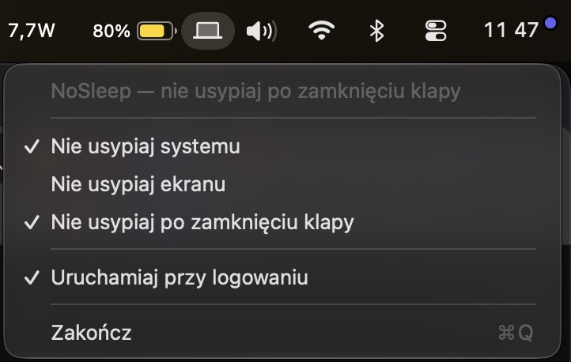

# NoSleep

> Prosta aplikacja na macOS, która zapobiega uśpieniu Maca — systemu, ekranu lub obu jednocześnie.

[](https://developer.apple.com/macos/)
[](https://swift.org/)
[](LICENSE)

## 📸 Zrzut ekranu



## ✨ Funkcje

| Funkcja | Opis |
|---|---|
| **Nie usypiaj systemu** | Zapobiega uśpieniu całego Maca z powodu bezczynności (ekran może gasnąć) |
| **Nie usypiaj ekranu** | Zapobiega wyłączaniu się ekranu z powodu bezczynności |
| **Tryb zamkniętej klapy** | Pozwala pracować z zamkniętą pokrywą MacBooka — ekran gaśnie, ale system działa |
| **Automatyczne wykrywanie klapy** | Po zamknięciu klapy ekran gaśnie; po otwarciu się budzi |
| **Uruchamianie przy logowaniu** | Działa w tle od momentu zalogowania |
| **Ikona w menu bar** | Różne stany: księżyc (wyłączone), księżyc z kropkami (system), świecący księżyc (system + ekran), laptop (tryb klapy) |
| **Przytrzymaj prawy przycisk** | Szybkie przełączanie między trybami |

## 🛠 Jak to działa

NoSleep używa trzech mechanizmów:

1. **`ProcessInfo.beginActivity`** — do zapobiegania uśpieniu systemu i ekranu przez bezczynność (bez uprawnień root)
2. **`pmset -a disablesleep`** — do blokady snu przy zamkniętej klapie (wymaga jednorazowego uprawnienia sudo)
3. **IOKit** — do odczytu stanu klapy (`AppleClamshellState` z `IOPMrootDomain`)

Aplikacja tworzy regułę `sudoers` (`/etc/sudoers.d/nosleep`), która pozwala na wykonywanie `pmset -a disablesleep 0|1` bez hasła — jednorazowy prompt przy pierwszym użyciu trybu klapy.

## 📦 Instalacja

### Opcja 1: Budowanie z kodu źródłowego

```bash
# Sklonuj repozytorium
git clone https://github.com/kamil004/NoSleep.git
cd NoSleep

# Zbuduj aplikację
chmod +x build-app.sh
./build-app.sh
```

Aplikacja pojawi się w folderze `dist/NoSleep.app`.

### Opcja 2: Swift Package Manager

```bash
swift build -c release
```

## 🏗 Budowanie

Skrypt `build-app.sh` automatycznie:

1. Kompiluje kod za pomocą `swiftc` (tryb release, optymalizacje)
2. Generuje ikony w wszystkich wymaganych rozmiarach z pliku PNG
3. Składa `.app` bundle z `Info.plist` i ikoną

## 🔒 Uprawnienia

- **Usypianie systemu/ekranu** — nie wymaga uprawnień administratora
- **Tryb zamkniętej klapy** — wymaga jednorazowego potwierdzenia hasła administratora przy instalacji reguły `sudoers`
- **Uruchamianie przy logowaniu** — wymaga rejestracji przez `SMAppService`

## 📁 Struktura projektu

```
NoSleep/
├── Package.swift              # Opis pakietu Swift
├── build-app.sh               # Skrypt budujący aplikację .app
├── README.md
├── screenshot.jpg
├── Sources/NoSleep/
│   └── NoSleepApp.swift       # cała logika (499 linii)
└── dist/
    └── NoSleep.app            # wybudowana aplikacja
```

Jednoplikowa aplikacja — cała logika w jednym pliku `NoSleepApp.swift`.

## ⚙️ Wymagania

- **macOS 13.0 Ventura** lub nowszy
- **Swift 6.0** lub nowszy
- MacBook z zamkniętą pokrywą (dla trybu klapy)

## 🚫 Zastosowanie

- Streaming / pobieranie plików przez noc
- Renderowanie / kompilacja bez zakłóceń
- Praca z zamkniętym MacBookiem podłączonym do monitora (clamshell mode)
- Prezentacje / demo bez gasnącego ekranu

## 📝 Autor

Stworzone przez [Kamil Gorecki](https://github.com/kamil004)

## 📄 Licencja

MIT
